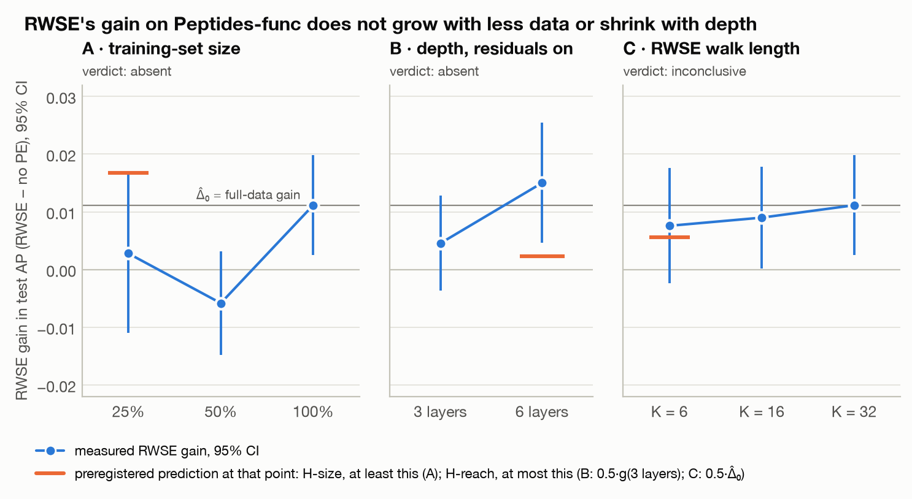

# Reach or size? Reproducing GNN+ and testing why RWSE helps

A blind reimplementation of GNN+ from [Luo, Shi & Wu, *Can Classic GNNs Be Strong Baselines for Graph-level Tasks?* (ICML 2025)](https://arxiv.org/abs/2502.09263), on 3 of the paper's 14 datasets (Peptides-func, Peptides-struct, ogbg-molhiv) with 2 of its 3 models (GCN+, GatedGCN+), 3 seeds per number.

It adds one preregistered extension. The paper explains its positional-encoding result by dataset size (Observation 6). We test that against two alternatives:
- **H-reach:** RWSE carries structure from beyond the message-passing receptive field.
- **H-local:** RWSE carries local structure that message passing cannot compute.

The full write-up is [REPORT.md](REPORT.md).

## Verdict

**The claim:** classic GNNs with six common additions ("GNN+") match or beat graph transformers on graph-level tasks.

- **The per-number claims reproduce** on all three datasets, each within the preregistered tolerance of twice the paper's std. molhiv sits at the low end.
- **The rankings:** first by mean on both Peptides datasets, but indistinguishable from the nearest competitors. "First on molhiv" is not supported: there, GatedGCN+ is last by mean, within noise of most models.
- **The text alone does not reproduce the result.** A model built from the paper's text scores 0.646 AP on Peptides-func, against 0.717 for one aligned with the released code. Most of the gap is head dropout and gradient clipping, which the paper never mentions.
- **Observation 6 is not supported on Peptides-func.** Cutting the training set to 25% does not enlarge RWSE's gain; it vanishes. Going from 3 to 6 layers does not shrink it; it grows. Whether the gain needs long walks is undecided at 3 seeds.

| Claim | Paper | Ours (3 seeds) | Verdict |
| --- | --- | --- | --- |
| C1 GCN+, Peptides-func, AP | 0.7261 ± 0.0067 | 0.7170 ± 0.0012 | reproduced (low end) |
| C2 GCN+, Peptides-struct, MAE ↓ | 0.2421 ± 0.0016 | 0.2435 ± 0.0002 | reproduced |
| C3a GatedGCN+, Peptides-func, AP | 0.7006 ± 0.0033 | 0.6990 ± 0.0090 | reproduced |
| C3b GatedGCN+, Peptides-struct, MAE ↓ | 0.2431 ± 0.0020 | 0.2444 ± 0.0008 | reproduced |
| C4a GCN+, molhiv, AUROC | 0.8012 ± 0.0124 | 0.7822 ± 0.0137 | reproduced |
| C4b GatedGCN+, molhiv, AUROC | 0.8040 ± 0.0164 | 0.7753 ± 0.0019 | reproduced (near the edge) |
| C5a RWSE drop, Peptides-func | 0.0192 | 0.0111 (2·SE 0.0088) | reproduced |
| C5b RWSE drop, molhiv | 0.0419 | 0.0258 (2·SE 0.0278) | not reproduced at 3 seeds; the authors' code agrees |
| R1–R3 rankings | first on all three | first by mean on Peptides, within noise; not first on molhiv | partly supported |
| C6 "RWSE matters because the data is small" | offered without a test | arm A absent, arm B absent, arm C inconclusive | not supported on Peptides-func |

Both baselines also reproduce: Tönshoff GCN on Peptides-func (C0) and OGB GCN on molhiv (C0b). [CLAIMS.md](CLAIMS.md) has every row with its tolerance.



*RWSE's gain on Peptides-func (RWSE minus no PE, test AP, 95% CI) in the three preregistered arms. Orange marks show what each hypothesis predicted. Details in [REPORT.md](REPORT.md) §7.*

## Repository

| Path | Contents |
| --- | --- |
| [REPORT.md](REPORT.md) | Methods, results, discrepancies, extension, limitations, reproduction instructions |
| [PREREGISTRATION.md](PREREGISTRATION.md) | Tolerances, environment checks, extension design, predictions and decision rules, fixed before any code. §7 logs every later change with its date. |
| [CLAIMS.md](CLAIMS.md) | Every claim with its target, tolerance and our result |
| [AMBIGUITIES.md](AMBIGUITIES.md) | A1–A17: what the paper leaves open, the blind defaults, and the parameter-count result |
| [DISCREPANCIES.md](DISCREPANCIES.md) | Paper vs. released code: 14 rows, with measured effects for the material ones |
| `src/` | The reimplementation (GCN+, GatedGCN+, Tönshoff and OGB GCN baselines), data loaders with RWSE, the synthetic ring task, the training loop |
| `configs/` | Configs as transcribed from the paper (`paper/`), paper-literal (`runs/`), code-aligned (`code/`), discrepancy and extension cells, training subsets, data fingerprints |
| `experiments/` | Every run in the report, one command per line |
| `analysis/` | Results to every table and figure |
| `results/` | Per-epoch CSVs and summaries for every run, plus the analysis outputs |
| `figures/` | Every figure, PNG and PDF |
| `tests/` | Unit tests, including the paper's exact parameter counts |

## Reproducing

```bash
python3.12 -m venv .venv && .venv/bin/pip install -r requirements.txt
.venv/bin/python -m src.data.precompute_rwse          # data + RWSE caches, checked against configs/data_fingerprints.json
.venv/bin/python -m pytest -q tests/
.venv/bin/python -m src.train configs/code/gcnplus_peptides-func.yaml --seed 0
.venv/bin/pip install -r requirements-figures.txt && .venv/bin/python -m analysis.figures
```

Versions are pinned in `requirements.txt` (Python 3.12, torch 2.14.1, torch_geometric 2.8.1, ogb 1.3.6). Running the experiment lists and the authors' code is described in [REPORT.md](REPORT.md) §10.

## Citation

If you use this reproduction, please cite it:

```bibtex
@misc{detroja2026reachorsize,
  author       = {Detroja, Vraj},
  title        = {Reach or size? Reproducing {GNN+} and testing why {RWSE} helps},
  year         = {2026},
  howpublished = {\url{https://github.com/vrajdetroja/reach-or-size}},
  note         = {GitHub repository}
}
```

and the original paper:

```bibtex
@inproceedings{luo2025classic,
  author    = {Luo, Yuankai and Shi, Lei and Wu, Xiao-Ming},
  title     = {Can Classic {GNNs} Be Strong Baselines for Graph-level Tasks? Simple Architectures Meet Excellence},
  booktitle = {Proceedings of the 42nd International Conference on Machine Learning},
  series    = {Proceedings of Machine Learning Research},
  volume    = {267},
  year      = {2025}
}
```

GitHub's "Cite this repository" button reads the same information from [CITATION.cff](CITATION.cff).

## License

MIT, see [LICENSE](LICENSE). The paper's reported numbers in `configs/paper/` and `CLAIMS.md` are quoted from Luo, Shi & Wu (ICML 2025) for comparison.
