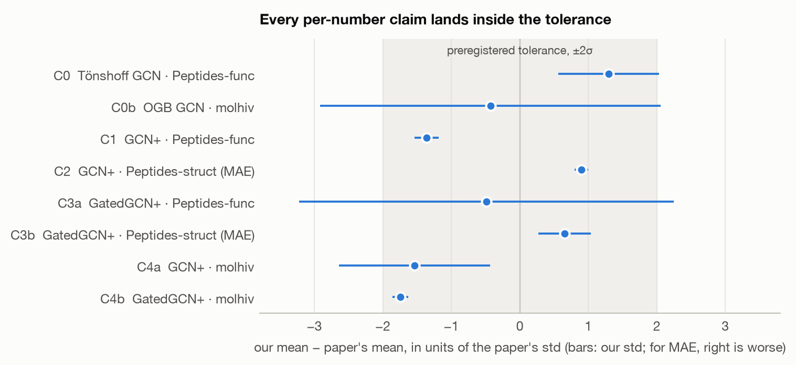
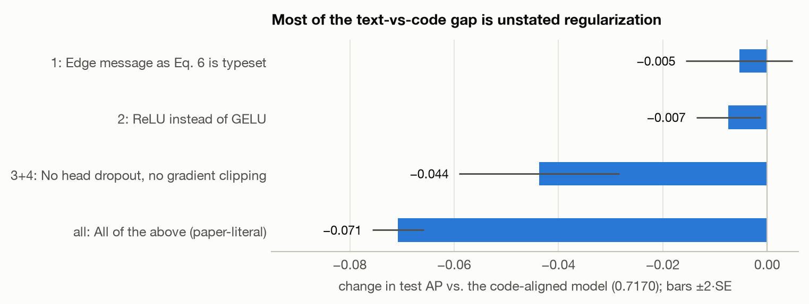
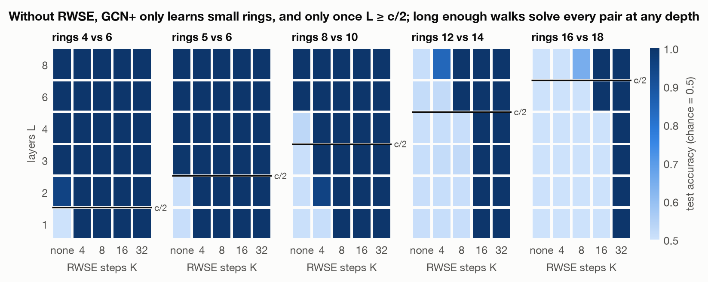
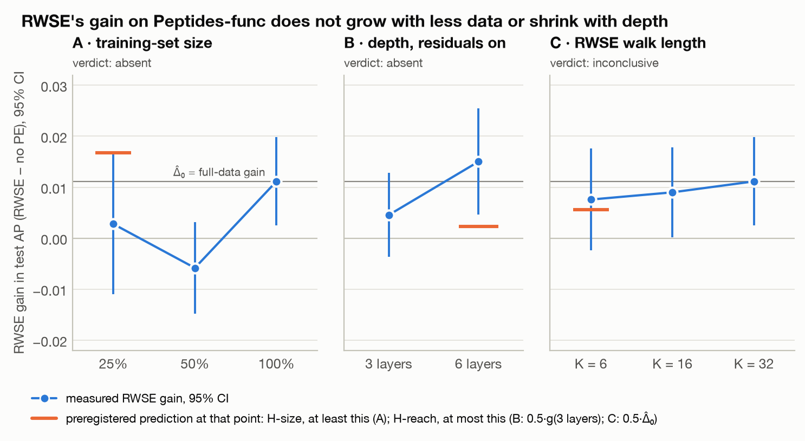
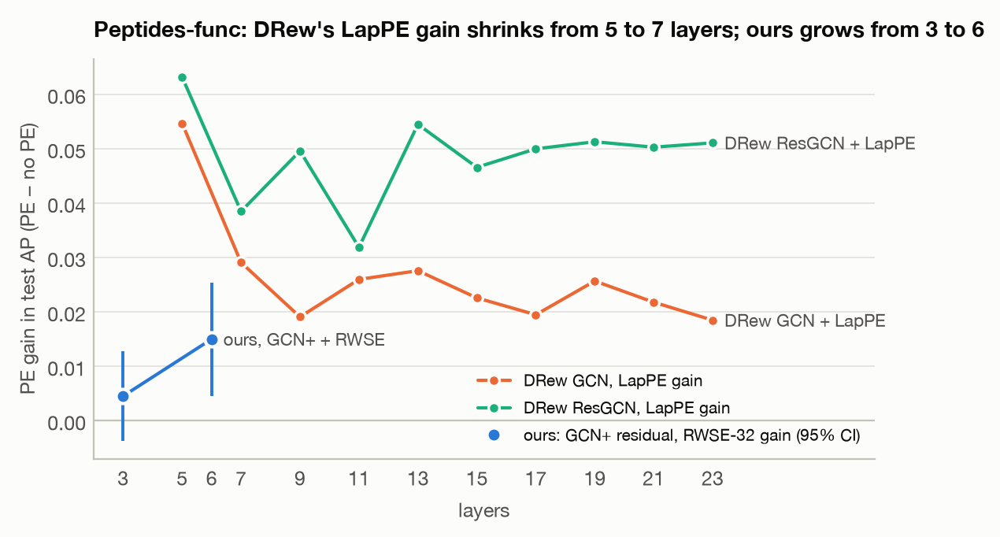

# Reach or size? Reproducing GNN+ (ICML 2025) and testing why RWSE helps

> Every number below is computed from the files in `results/`, and every figure is generated from them by `analysis/figures.py`. Every rule was fixed in `PREREGISTRATION.md` before the runs it governs; later changes are logged there with dates.

## 1. Abstract

We reproduce GNN+ ([Luo, Shi & Wu, ICML 2025](https://arxiv.org/abs/2502.09263)) on 3 of its 14 datasets (Peptides-func, Peptides-struct, ogbg-molhiv) with 2 of its 3 models (GCN+, GatedGCN+). Each number uses 3 seeds. **Our verdict covers only these datasets and models, not the paper's 14-dataset ranking claim.**

- **The headline numbers reproduce.** Every per-number claim is within the preregistered tolerance of twice the paper's standard deviation. On molhiv our numbers sit at the low end, and the claimed first place there is not supported.
- **The released code is needed to get there.** A model built from the paper's text alone scores 0.646 AP on Peptides-func, against 0.717 for one aligned with the released code. Most of that gap is regularization the paper does not describe: dropout in the prediction head and gradient clipping.
- **The paper's parameter counts carry most of the missing detail.** Matching its exact parameter counts recovered most of the undocumented architecture before we read the code.
- **The positional-encoding ablation reproduces on Peptides-func only.** On molhiv it does not clear the bar at 3 seeds, and the authors' own code shows the same smaller effect there.
- **The paper's explanation for RWSE's benefit fails on Peptides-func.** The paper says RWSE matters because the dataset is small. In a preregistered test, cutting the training set to 25% does not enlarge RWSE's gain; the gain vanishes. Going from 3 to 6 layers does not shrink it either, as a "reach" explanation would predict; it grows. Whether the gain needs long random walks is undecided at 3 seeds, though most of it is already there with 6-step walks.
- **A synthetic control bounds the mechanisms.** Without RWSE, GCN+ needs exactly 3 layers, the tuned depth, to tell 5-rings from 6-rings, and it fails to learn rings of 12 or more within 8 layers. RWSE with long enough walks removes both limits.

## 2. Claims

The full inventory is in `CLAIMS.md`: per-number claims C0–C5b, ranking claims R1–R3, scope and tolerances. The paper reports 5 seeds; we run 3. A claim reproduces if our 3-seed mean lies within 2 × the paper's reported std of the paper's mean (preregistered, §3.1). C6, the paper's explanation for its positional-encoding result (Observation 6), is tested by the extension in §7.

## 3. Methodology

1. **Preregistration first.** The scope, tolerances, environment checks, extension design, predictions and decision rules were committed (`a3b7b87`) before any code, with three design decisions (D1–D3). Later changes appear in §7 of the preregistration with their dates and whether they came before or after the relevant results. There are four:
   - the environment checks run on CPU;
   - reproduction and extension use the code-aligned implementation (§3.4 below);
   - precise BatchNorm statistics in the synthetic control (§7.3);
   - numeric accuracy bands for the synthetic predictions (§7.3).
2. **Blind reimplementation from the paper.** GCN+ and GatedGCN+ were written in PyTorch Geometric from Eqs. 4 and 6–12 and Tables 9 and 13. Every unclear point became a config flag tied to a row in `AMBIGUITIES.md` (A1–A17). The GNNPlus repository stayed unopened until the parameter-count result was committed (`e74ab83`); it was first opened at `58da50d`. Blind means the repository was not opened. It does not rule out earlier exposure to the public code.
3. **Parameter-count matching.** Tables 9 and 13 report an exact parameter count for every tuned config. We enumerated 768 architecture readings for GCN+ and 48 for GatedGCN+, combined with head shapes and RWSE widths per dataset. We kept the readings that hit all three in-scope counts per model. Section 6 gives the result.
4. **Code diff and code-aligned implementation.** We compared the released code (`0e02ad9`) against the paper (`DISCREPANCIES.md`, 14 rows) and added its explicit choices to our implementation as options (`configs/code/`). Every code-aligned config still has the paper's exact parameter count. Headline runs use the code-aligned implementation; the paper-literal reading is measured as a discrepancy (§5). The switch was logged before any reproduction run, and after the environment checks' single-seed runs, which the log states.
5. **Environment checks.** A tuned GCN baseline had to reproduce, and the authors' code had to hit its own number in our environment. Both passed (§4).
6. **Environment.** Headline runs used an NVIDIA RTX 4090, with package versions pinned (`requirements.txt`). Every data split was checked byte for byte against `configs/data_fingerprints.json` before training, and the authors' rdkit featurization gives byte-identical Peptides-func graphs (`DISCREPANCIES.md` row 13). Test scores are taken at the best-validation epoch, as in the released code.

## 4. Reproduction results

All 3 seeds, test metric at the best-validation epoch, RTX 4090, code-aligned GNN+ (`results/all_runs.csv`, `results/reproduction_summary.md`).

| Claim | Model, dataset, metric | Paper | Ours | Δ | Tolerance (±2σ) | Verdict |
| --- | --- | --- | --- | --- | --- | --- |
| C0 | Tönshoff GCN, Peptides-func, AP (environment check, CPU) | 0.6860 ± 0.0050 | 0.6925 ± 0.0037 | +0.0065 | 0.0100 | reproduced |
| C0b | OGB GCN, molhiv, AUROC | 0.7606 ± 0.0097 | 0.7565 ± 0.0241 | −0.0041 | 0.0194 | reproduced |
| C1 | GCN+, Peptides-func, AP | 0.7261 ± 0.0067 | 0.7170 ± 0.0012 | −0.0091 | 0.0134 | reproduced (low end) |
| C2 | GCN+, Peptides-struct, MAE ↓ | 0.2421 ± 0.0016 | 0.2435 ± 0.0002 | +0.0014 | 0.0032 | reproduced |
| C3a | GatedGCN+, Peptides-func, AP | 0.7006 ± 0.0033 | 0.6990 ± 0.0090 | −0.0016 | 0.0066 | reproduced |
| C3b | GatedGCN+, Peptides-struct, MAE ↓ | 0.2431 ± 0.0020 | 0.2444 ± 0.0008 | +0.0013 | 0.0040 | reproduced |
| C4a | GCN+, molhiv, AUROC | 0.8012 ± 0.0124 | 0.7822 ± 0.0137 | −0.0190 | 0.0248 | reproduced |
| C4b | GatedGCN+, molhiv, AUROC | 0.8040 ± 0.0164 | 0.7753 ± 0.0019 | −0.0287 | 0.0328 | reproduced (near the edge) |

Seeds 0, 1 and 2 for every row.



*Figure 1. Each claim's distance from the paper, in units of the paper's own std. The gray band is the preregistered tolerance; the bars are our seed std. Table above.*

**"GNN+" is not six components in any tuned config.** The paper presents GNN+ as six additions to a classic GNN. The tuned configs (Tables 9 and 13; `configs/code/`) switch several off:

| Config | Edge features | BatchNorm | Dropout | Residual | FFN | RWSE steps |
| --- | --- | --- | --- | --- | --- | --- |
| GCN+, Peptides-func | yes | yes | 0.2 | no | no | 32 |
| GCN+, Peptides-struct | no | yes | 0.2 | no | no | 32 |
| GatedGCN+, Peptides-func | yes | yes | 0.05 | no | no | 32 |
| GatedGCN+, Peptides-struct | yes | yes | 0.2 | yes | no | 32 |
| GCN+, molhiv | yes | yes | 0.1 | no | yes | 20 |
| GatedGCN+, molhiv | yes | yes | 0 | yes | no | 20 |

On Peptides-func, GCN+ is four of the six components; on Peptides-struct it is three. The FFN appears in one config of the six.

**C1 against the authors' code.** In the environment checks, the authors' code scored 0.7187 on one seed, so their own code also lands below the paper's 0.7261 in our environment.

**Positional-encoding ablations.** The preregistered rule: the drop with RWSE removed must exceed 2 × SE.

| Claim | Dataset | Paper drop | Our drop | 2·SE | Verdict |
| --- | --- | --- | --- | --- | --- |
| C5a | Peptides-func | 0.0192 | 0.0111 (0.7170 → 0.7058 ± 0.0076) | 0.0088 | reproduced |
| C5b | molhiv | 0.0419 | 0.0258 (0.7822 → 0.7564 ± 0.0198) | 0.0278 | **not reproduced at 3 seeds** |

The preregistration (§3.3) requires two checks before calling a claim not reproduced: measuring the material discrepancies, and running the authors' code on the same claim. Here, the authors' code on GCN+ molhiv gives 0.7769 ± 0.0142 with RWSE and 0.7640 ± 0.0070 without, a drop of 0.0129 against its own 2·SE of 0.0183 (`results/c5b_control.md`). Both implementations agree. The drop has the right sign but is smaller than reported and within 3-seed noise; a decisive test would need about 5–6 seeds per arm.

**Ranking claims.** Preregistered rule, with competitor seed counts set to 1, the conservative choice (`results/rankings.md`).
Competitors are the methods the paper compares against: graph transformers, state-space models and other specialised architectures such as DRew (17 on each Peptides task, 9 non-pretrained on molhiv). The paper's own classic-GNN rows and GNN+ variants are not competitors for this claim; by mean, its GIN+ (0.2429) and GatedGCN+ (0.2431) would edge out our GCN+ (0.2435) on Peptides-struct.
- **R1, Peptides-func:** GCN+ is first by mean among the 17 cited competitors. It is indistinguishable from DRew and GSSC and clearly ahead of the rest.
- **R2, Peptides-struct:** GCN+ is first by mean. It is indistinguishable from Graph ViT/MLP-Mixer, MGT, GRED and GSSC.
- **R3, molhiv:** GatedGCN+ (0.7753) is **last by mean** among the 9 non-pretrained competitors cited. It is indistinguishable from 8 of them; Graph ViT/MLP-Mixer (0.7997) is ahead by more than the margin. "First on molhiv" is not supported.

## 5. Discrepancies: what the paper's text leaves out

The code diff found 14 differences (`DISCREPANCIES.md`). Three groups do not change the parameter count and were measured on GCN+ Peptides-func, 3 seeds each, against the code-aligned C1 baseline (0.7170 ± 0.0012).

| Row | Paper reading restored | Test AP | Effect | 2·SE | Material? |
| --- | --- | --- | --- | --- | --- |
| 1 | Edge message exactly as Eq. 6 is typeset | 0.7116 ± 0.0088 | −0.0054 | 0.0102 | no |
| 2 | ReLU (the paper's example activation) instead of GELU | 0.7095 ± 0.0052 | −0.0074 | 0.0062 | yes, small |
| 3+4 | No dropout in the prediction head, no gradient clipping (neither is mentioned in the paper) | 0.6733 ± 0.0132 | **−0.0437** | 0.0154 | **yes** |
| all | All three: the model the text describes | 0.6462 ± 0.0041 | **−0.0708** | 0.0050 | **yes** |



*Figure 2. Change in test AP when each reading from the paper's text replaces the released code's choice, with ±2·SE bars. Table above.*

**A model built from the text alone does not reproduce C1.** It misses by 0.08 AP, against a tolerance of 0.013. Most of the shortfall comes from unstated regularization in a deep prediction head that the paper does not describe either: 3–4 linear layers, recovered from the parameter counts. The edge message as written barely matters on its own, even though it was the most visible difference in the code diff. The factors compound when combined.

## 6. Ambiguities and how they were resolved

`AMBIGUITIES.md` lists 17 ambiguities. Parameter-count matching resolved most of the architecture ones before the code was opened:
- **GCN+:** exactly one reading matched all three reported counts.
- **GatedGCN+:** one reading matched, up to an FFN width that no in-scope config uses.

The code confirmed these readings:
- no per-layer edge weights, with one shared bond embedding (contrary to Eq. 6's W_e^l);
- the GraphGPS RWSE encoder with widths 28 and 16;
- the Dwivedi-style gated layer with edge updates;
- a bond encoder present even when the edge module is off;
- FFN width 2d;
- 5 of the 6 prediction heads.

One reading was wrong. GCN+ molhiv has a 3-layer head and a second FFN BatchNorm, not a 4-layer head. Both cost exactly 1,407,641 parameters, and the second BatchNorm was outside our search space. The method cannot detect choices that cost no parameters, and those are exactly the material rows in §5. The size of the hyperparameter search (A5) and the retrained transformer numbers (A6) are not reported in the paper; we treat them as unknown.

## 7. Extension: why does RWSE help?

Preregistered in `PREREGISTRATION.md` §5:
- **Hypotheses:** H-size (the paper's explanation), H-reach and H-local.
- **Arms:** A (training size), B (depth), C (walk length).
- **Decision rules and power analysis,** fixed before any run.
- **A synthetic ring-size control** on CPU.

The arms reuse the reproduction's C1 and C5a cells as their full-data, 3-layer, RWSE-32 and no-PE cells.

### 7.1 The decision rules with measured numbers

The rules are fixed (§5.5, §6). This restates them with our own numbers in place of the paper's, before any arm runs (`analysis/thresholds.py`, `results/thresholds.md`).

- **Precondition met.** C5a reproduced, so the extension may start (§5.2).
- **The gain under study is smaller than the paper's.** Δ̂₀ = 0.0111 (paper 0.0192), so the smallest effect any hypothesis predicts is m = 0.5·Δ̂₀ = 0.0056. Δ̂₀ is only 2.5 of its own standard errors.
- **The seed stds are lopsided.** C1, with RWSE, has std 0.0012. C5a, without RWSE, has 0.0076. A 3-seed std is itself uncertain (95% interval about 0.5× to 6.3× the estimate), so the table also uses the paper's pooled 0.0081.

| Arm, std assumption | SE of X | Positive needs X̂ > | Power at X = m | Power at X = Δ̂₀ | P("absent") if X = 0 |
| --- | --- | --- | --- | --- | --- |
| A, B: measured stds | 0.0063 | 0.0125 | 0.13 | 0.41 | 0.23 |
| A, B: paper std | 0.0094 | 0.0187 | 0.08 | 0.21 | 0.15 |
| C: K = 6 as stable as K = 32 | 0.0010 | 0.0019 | 1.00 | 1.00 | 1.00 |
| C: K = 6 as noisy as no PE | 0.0044 | 0.0088 | 0.23 | 0.70 | 0.35 |
| C: paper std | 0.0066 | 0.0132 | 0.12 | 0.38 | 0.21 |

What this means:
- **Arms A and B will almost certainly be inconclusive.** A positive call needs a change in the gain larger than the whole measured gain. For H-size, the gain at 25% data would have to be at least 0.024, more than twice Δ̂₀. Even if nothing changes, "absent" is reached only about one time in four. The preregistration anticipated this (§5.6); the extra-seed rule stands.
- **Arm C is the informative arm, and its power depends on one unknown.** If the RWSE-6 cell is as stable across seeds as RWSE-32 (std 0.0012), arm C decides either way. If it is as noisy as the no-PE cell, power drops to 0.70 at the full effect. The H-local pattern also needs ĝ(6) > 0.0088, 79% of Δ̂₀.
- **No amendment.** Nothing in these numbers triggers one. They set expectations for the write-up, and they are on record before any arm runs.

In the event, arms A and B both came out "absent" rather than inconclusive, because both estimates were negative (§7.4).

### 7.2 Prior evidence: PE gain vs. depth in DRew

DRew (Gutteridge et al., ICML 2023, App. B.5, Figs. 4–5) trained GCN and residual GCN on Peptides-func with 500k parameters, depth 5 to 23, with and without LapPE. We digitized both figures from the arXiv HTML version's vector SVGs (`analysis/drew_digitize.py`, `results/drew_digitized.csv`). Each value is the midpoint of the plotted error bar, scaled by the gridlines. The script checks the series assignment against the two solid polylines. Coordinates are exact to about 10⁻⁵ AP, so the values are the plotted ones, not visual estimates.

| Layers | GCN | GCN + LapPE | Gain | ResGCN | ResGCN + LapPE | Gain |
| --- | --- | --- | --- | --- | --- | --- |
| 5 | 0.595 | 0.649 | +0.055 | 0.583 | 0.646 | +0.063 |
| 7 | 0.637 | 0.666 | +0.029 | 0.628 | 0.667 | +0.039 |
| 9 | 0.645 | 0.665 | +0.019 | 0.613 | 0.663 | +0.050 |
| 11 | 0.643 | 0.669 | +0.026 | 0.624 | 0.656 | +0.032 |
| 13 | 0.641 | 0.669 | +0.028 | 0.608 | 0.662 | +0.054 |
| 15 | 0.639 | 0.662 | +0.023 | 0.614 | 0.661 | +0.047 |
| 17 | 0.637 | 0.656 | +0.020 | 0.606 | 0.656 | +0.050 |
| 19 | 0.630 | 0.655 | +0.026 | 0.604 | 0.655 | +0.051 |
| 21 | 0.626 | 0.648 | +0.022 | 0.593 | 0.643 | +0.050 |
| 23 | 0.618 | 0.637 | +0.018 | 0.594 | 0.645 | +0.051 |

Figure 5 (§7.4) plots these gains next to ours.

Reading:
- **The gain shrinks once, at shallow depth.** From 5 to 7 layers it falls by 47% for GCN and 39% for residual GCN. Most of that comes from the no-PE model improving (+0.042 for GCN) rather than from the PE model getting worse. This is the pattern H-reach predicts, and it sits where our arm B looks (3 vs. 6 layers).
- **After that, the gain does not shrink.** From 7 to 23 layers it stays at +0.018 to +0.029 for GCN (mean +0.023) and +0.032 to +0.054 for residual GCN (mean +0.047), although the receptive field triples. Either the gain is local in the H-local sense, or deep message passing cannot use the extra reach. Peptides graphs are long: mean diameter 57 (our count over all 15,535 graphs, as in LRGB), and 60% of them have diameter above 46. In those graphs no node sees the whole graph even at 23 layers.
- **How far it transfers.** LapPE is a global positional encoding and RWSE a local structural one. DRew's models are untuned LRGB-style baselines, not the tuned GNN+ regime, and the width shrinks with depth at a fixed parameter count. Our arms keep the parameter count fixed in the same way (§5.3). The figure is the closest prior evidence, but it cannot settle our question.

### 7.3 Synthetic ring-size control

**Setup.** The grid has 450 runs: 5 ring pairs × L ∈ {1, 2, 3, 4, 6, 8} × RWSE-K ∈ {none, 4, 8, 16, 32} × 3 seeds. It ran on CPU (`results/synthetic.md`, `analysis/synthetic.py`). Each graph is a path with one ring of size c or c′ attached; the label says which. Node features are constant, and graph size carries no signal.

Two settings were fixed after debugging runs and logged before the grid (`PREREGISTRATION.md` §7):
- **Precise BN.** With constant node features, eval-mode BatchNorm statistics collapsed the outputs to one class while training accuracy was 1.0. BatchNorm statistics are now recomputed over the training set before each evaluation.
- **Accuracy bands.** "Near chance" means a cell mean below 0.60; "high" means 0.90 or more. These were fixed after the first 6 runs had been seen.



*Figure 4. Mean test accuracy over 3 seeds for each ring pair, depth L and RWSE walk length K. The black line marks L = c/2, the depth at which message passing first reaches across the smaller ring. Full table: `results/synthetic.md`.*

**Smallest depth at which the task is solved** (mean test accuracy ≥ 0.90 over 3 seeds; chance is 0.5):

| Rings | c/2 | No PE | RWSE-4 | RWSE-8 | RWSE-16 | RWSE-32 |
| --- | --- | --- | --- | --- | --- | --- |
| 4 vs 6 | 2 | 2 | 1 | 1 | 1 | 1 |
| **5 vs 6** | 2.5 | **3** | 1 | 1 | 1 | 1 |
| 8 vs 10 | 4 | 6 | 2 | 1 | 1 | 1 |
| 12 vs 14 | 6 | > 8 | > 8 (2 of 3 seeds at L = 8) | 6 | 1 | 1 |
| 16 vs 18 | 8 | > 8 | > 8 | > 8 (1 of 3 seeds at L = 8) | 6 | 1 |

Of the 150 cells, 148 are either at 0.95 or above, or at 0.53 or below. In the other two, the seeds split: some solve the task and the rest stay at chance.

**The preregistered predictions** (§5.7), for the pair (c, c′):

| Prediction | Result |
| --- | --- |
| H-reach, no PE: chance for L < c/2 | **Holds** in all 15 cells, across all 5 pairs. |
| H-reach, no PE: high once L ≥ c/2 | **Holds only for small rings.** It holds at L = c/2 for 4/6 and 5/6. For 8/10 it takes L = 6 (c/2 + 2). For 12/14 and 16/18 no depth up to 8 works, and training accuracy also stays at about 0.5: the model fails to fit, rather than overfitting. |
| H-reach, RWSE-K with K ≥ c: high at every L | **Holds for c ≤ 12** (72 of 72 cells). For 16/18, RWSE-16 fails at L ≤ 4. A walk that wraps once around a ring of size c returns with probability of order 2⁻ᶜ, about 10⁻⁵ at c = 16, so walks a little longer than c are needed before the ring shows up. |
| H-local, no PE: still chance at L ≥ c/2 + 2 | **Fails for 4/6, 5/6 and 8/10:** GCN+ reaches 1.0 there. **Holds for 12/14**, where L = 8 is the only testable cell. Not testable for 16/18 in this grid. |

**Not preregistered: reach from RWSE and from depth add up.** With walks shorter than the ring (K < c), RWSE still solves the task once its local marks and L layers of message passing together span the ring. RWSE-4 with 1 layer separates 5- from 6-rings, and RWSE-4 with 2 layers separates 8 from 10. For larger rings the combined reach needed grows faster than c/2; RWSE-8 needs 6 layers for 12/14. The analysis checked a naive version of this, chance whenever K < c and L < c/2. That check is labelled as not preregistered, and it fails in exactly these cells.

**What it means for Peptides-func.**
- **Both mechanisms are possible in GCN+, depending on structure size.** For small rings, message passing computes ring size as soon as it reaches them, so the H-local mechanism does not apply there. For rings of 12 or more, GCN+ fails to learn ring size inside its receptive field at 8 layers, and RWSE supplies it.
- **The chemically relevant case sits at the boundary.** Without RWSE, telling 5- from 6-rings takes exactly 3 layers, the depth of the tuned Peptides-func GCN+. With any RWSE it takes 1. On ring structure, the tuned model is at the edge of its reach, so the two hypotheses are not exclusive: structure that is local in the chemical sense is also at the limit of a 3-layer model's reach.
- **How to read arms B and C together.** Suppose 5- and 6-ring structure carried the Peptides gain. Arm B would then show the gain shrinking at 6 layers, and RWSE-6 would already capture it in arm C (X_C ≈ 0). That combination points to structure within about three hops, not to distant structure. The preregistered joint-reading table is unchanged; §7.4 (point 3) applies this reading.

**Limits.**
- One training setting: 60 epochs, width 64, lr 10⁻³. "Fails to learn" here does not prove the model cannot represent ring size at that depth.
- The graphs are minimal: one ring, constant features, no edge features. Peptides have atom and bond features and several rings per molecule.
- As §5.7 says, a clean synthetic result shows that a mechanism is possible, not that it operates on Peptides.

### 7.4 Arms A–C

**Analysis.** `analysis/extension.py` applies the decision rules, the joint reading and the extra-seed rule as §5.5–5.6 state them. It was committed, with unit tests, before any arm ran (`a2f541c`). Output: `results/extension.md`.

Test AP at best validation, 3 seeds per cell. The 100% cells are C1 and C5a from the reproduction.

| Condition | RWSE-32 | No PE | Gain g | SE |
| --- | --- | --- | --- | --- |
| Tuned config (3 layers, no residuals), 100% data | 0.7170 ± 0.0012 | 0.7058 ± 0.0076 | **+0.0111** | 0.0044 |
| 50% of the training set | 0.6416 ± 0.0072 | 0.6474 ± 0.0034 | −0.0058 | 0.0046 |
| 25% of the training set | 0.5852 ± 0.0092 | 0.5824 ± 0.0079 | +0.0028 | 0.0070 |
| 3 layers, residuals on | 0.7078 ± 0.0068 | 0.7032 ± 0.0025 | +0.0046 | 0.0042 |
| 6 layers, residuals on | 0.7077 ± 0.0041 | 0.6927 ± 0.0082 | **+0.0150** | 0.0053 |

Walk length, tuned config: no PE 0.7058 ± 0.0076, RWSE-6 0.7134 ± 0.0045, RWSE-16 0.7148 ± 0.0017, RWSE-32 0.7170 ± 0.0012.

| Arm | Contrast X | X̂ | SE | m | Rule | Verdict |
| --- | --- | --- | --- | --- | --- | --- |
| A | g(25%) − g(100%) | −0.0084 | 0.0083 | 0.0056 | X̂ + 1.645·SE = 0.0053 < m | **absent** |
| B | g(L=3) − g(L=6) | −0.0105 | 0.0068 | 0.0023 | X̂ + 1.645·SE = 0.0007 < m | **absent** |
| C | mean(K=32) − mean(K=6) | +0.0036 | 0.0027 | 0.0056 | neither bound | **inconclusive** |



*Figure 3. RWSE's gain (RWSE − no PE, test AP, 95% CI) in each arm. The orange marks show what each hypothesis predicted at that point: H-size predicted at least the mark (A); H-reach predicted at most the mark (B, C). Tables above.*

**Joint reading, as preregistered: inconclusive with the seeds run.** None of the §5.5 patterns holds. No arm qualifies for the extra-seed rule: A and B have negative X̂, and C is not eligible (§5.6).

What the arms do show:
1. **H-size is not supported on Peptides-func.** H-size predicted the gain at 25% data would be at least 1.5·Δ̂₀ ≈ 0.017. That is ruled out at one-sided 95%, though narrowly: the upper bound is 0.0053 against m = 0.0056. At 25% and 50% of the data, RWSE's gain cannot be told from zero; it appears only with the full training set. Cutting the data to 25% costs both models 0.12–0.13 AP, and RWSE recovers none of it. Both PE settings share the fixed-step design (D1), so a 25% model sees each graph four times as often as a full-data model.
2. **The gain does not shrink with depth; it grows.** With residuals on, it rises from +0.005 at 3 layers, which cannot be told from zero, to +0.015 at 6 layers. Without RWSE, the 6-layer model is 0.011 worse than the 3-layer one; with RWSE, the extra depth costs nothing (0.7078 vs. 0.7077). So arm B's H-reach prediction fails. Two caveats:
   - m_B = 0.5·ĝ(L=3) is small, because the 3-layer residual gain is itself weak.
   - The pattern is the reverse of DRew's (§7.2), where LapPE's gain shrank from 5 to 7 layers. The PE and the training regime both differ (Figure 5).
3. **The structure at the edge of a 3-layer model's reach doesn't explain the gain either.** §7.3 found that a 3-layer model can only just tell 5-rings from 6-rings, and that 6 layers have reach to spare. If that ring structure carried the gain, it should have shrunk at 6 layers. It grew.
4. **Walk length is undecided.** Mean AP rises with K, and RWSE-6 already recovers 68% of the gain (0.0076 of 0.0111). But neither the remaining difference (X_C = 0.0036 ± 0.0027) nor g(6) itself clears its bound. At the measured effect, a decision would take about 7 seeds per cell for "positive", or 15 for "absent". The extra-seed rule does not extend arm C, so it stays open.

**Overall.** The central predictions of two hypotheses failed: H-size's in arm A and H-reach's in arm B. The arm that would separate H-reach from H-local did not decide. The remaining pattern fits H-local, or RWSE doing more than one job:
- most of the gain comes with short walks;
- it does not depend on training-set size;
- depth does not replace it.

H-local's own preregistered pattern (arm C absent, with ĝ(6) − 2·SE > 0) was not met, so we do not claim it.



*Figure 5. PE gain against depth on Peptides-func. The orange and green lines are DRew's LapPE gains for GCN and residual GCN, digitized (§7.2). The blue points are our RWSE gains for residual GCN+ at 3 and 6 layers, with 95% CIs. The encodings and training regimes differ.*

## 8. What this means for the original claim

The claim holds on both Peptides datasets: GNN+ matches the paper's numbers and leads the cited competing methods by mean, though by margins seed noise cannot separate from the nearest competitors. On molhiv the numbers are within tolerance but low, and the ranking is within noise. Separately, the paper's text is not enough to reproduce its own Peptides-func result. Reproducing it takes the released code, or a close reading of its parameter counts plus details the text never states.

On *why* RWSE helps, the paper's Observation 6 — that RWSE matters because the dataset is small — does not survive a direct test on Peptides-func. The gain does not grow when the training set shrinks, and it does not shrink when the model gets deeper. What is left is a small gain of about 0.011 AP, most of it present with walks of only 6 steps, which more depth does not replace. That fits a local-structure explanation, but our walk-length arm is not powered to establish it, and we do not claim it.

## 9. Limitations

- 3 of 14 datasets, 2 of 3 models, 3 seeds rather than 5, no transformer retraining.
- The extension tests one dataset (Peptides-func) and one model (GCN+). Arm C is undecided at 3 seeds, and arm B's base gain at 3 layers with residuals is itself weak.
- The environment checks used single-seed harness runs on CPU (a logged deviation).
- RTX 4090 rather than the paper's RTX 3090, so the paper's timing claims are not tested.
- Competitor seed counts were not transcribed. The ranking rule uses n = 1, which can only shrink gaps.
- Blind means the released repository was not opened before the parameter-count result. Earlier exposure to the public code cannot be ruled out.

## 10. Reproduction instructions

```bash
python3.12 -m venv .venv && .venv/bin/pip install -r requirements.txt
.venv/bin/python -m src.data.precompute_rwse          # data + RWSE caches, checked against configs/data_fingerprints.json
.venv/bin/python -m pytest -q tests/                  # unit tests, including the paper's exact parameter counts
.venv/bin/python -m src.train configs/code/gcnplus_peptides-func.yaml --seed 0
```

Every run in this report is one line in `experiments/`:

| File | Runs | What |
| --- | --- | --- |
| `experiments/env_checks.txt` | 6 | Tönshoff GCN (C0) and the GCN+ harness checks, on CPU |
| `experiments/reproduction.txt` | 27 | Every headline cell, seeds 0–2 |
| `experiments/discrepancy.txt` | 12 | One paper reading restored per config (§5) |
| `experiments/c5b_authors_code.txt` | 6 | The authors' GCN+ on molhiv with and without RWSE |
| `experiments/synthetic.txt` | 450 | The synthetic ring-size grid, on CPU |
| `experiments/extension.txt` | 30 | Arms A–C |

Each line is an independent command run from the repository root, so a list can run in parallel, for example `grep -v '^#' experiments/reproduction.txt | xargs -P 4 -I{} sh -c '{}'`.

**The authors' code** (environment check 2 and the C5b control) runs from a checkout at `0e02ad9` in its own environment:
```bash
git clone https://github.com/LUOyk1999/GNNPlus third_party/GNNPlus && git -C third_party/GNNPlus checkout 0e02ad9
scripts/setup_gnnplus_env.sh                         # Python 3.10, torch 2.2.0, PyG 2.3.1 in third_party/.venv-gnnplus
export GNNPLUS_VENV=$PWD/third_party/.venv-gnnplus   # absolute: the commands cd into the checkout
mkdir -p data/gnnplus/peptides-functional/701eb743e899f4d793f0e13c8fa5a1b4   # their loader otherwise asks before re-downloading
$GNNPLUS_VENV/bin/python -c "from ogb.graphproppred import PygGraphPropPredDataset as D; D('ogbg-molhiv', root='data/gnnplus')"   # build molhiv once, before parallel runs
```

Analyses: `python -m analysis.aggregate`, `analysis.rankings`, `analysis.env_checks`, `analysis.discrepancy`, `analysis.c5b_control`, `analysis.thresholds`, `analysis.synthetic` and `analysis.extension`. `python -I analysis/drew_digitize.py DIR` digitizes DRew Figs. 4–5 from the two SVGs in the arXiv HTML version of 2305.08018v2, saved in `DIR` as `ablation_no_pe.svg` and `ablation_lappe.svg`.

Figures: `.venv/bin/pip install -r requirements-figures.txt` (matplotlib 3.11.2), then `python -m analysis.figures`, which writes `figures/*.png` and `*.pdf`.

- **Seeds.** 0, 1 and 2 for every run (`--seed`). The arm A subsets use subset seed 0 (`configs/subsets/`, hash-checked).
- **Data.** Every split's SHA-256 over node features, edges, edge features and labels is in `configs/data_fingerprints.json`; `python -m src.data.precompute_rwse` checks the local data against it.
- **Versions.** Python 3.12, torch 2.14.1 (CUDA 13.0 on the GPU), torch_geometric 2.8.1, ogb 1.3.6. The authors' code ran on Python 3.10 with torch 2.2.0 and PyG 2.3.1 (`configs/gnnplus/requirements.txt`).
